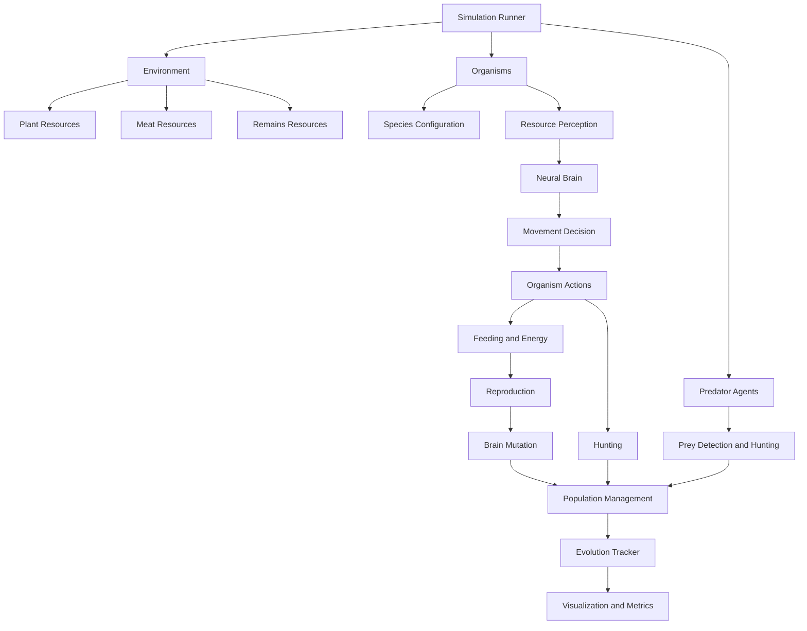
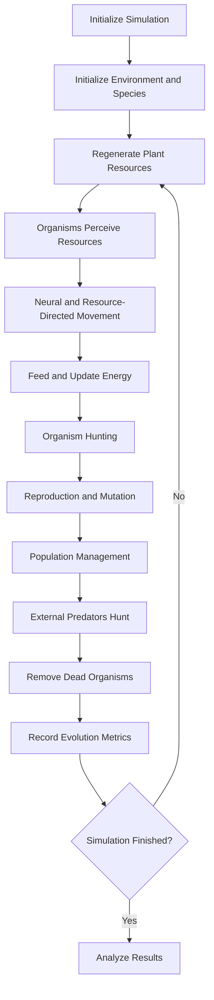

# Artificial Life - Digital Evolution Laboratory

A Python-based artificial-life simulation exploring how autonomous organisms survive, consume resources, reproduce, mutate, and interact in a dynamic environment.

Version 2 introduces a multi-species ecosystem with diet-specific resource perception, neural movement decisions, organism-level hunting, scavenging, reproduction, and evolutionary tracking.

## 1. Project Overview

The simulation includes:

- **Environment:** A 2D world containing regenerating plants, meat, and remains.
- **Multiple species:** Herbivores, carnivores, omnivores, and scavengers.
- **Autonomous organisms:** Each organism has its own neural brain and energy state.
- **Resource perception:** Organisms observe resources according to their dietary requirements.
- **Neural decision-making:** Neural networks contribute to movement decisions, combined with resource-directed movement.
- **Hunting:** Carnivorous and omnivorous organisms can hunt other species.
- **Scavenging:** Scavengers consume remains and meat.
- **Reproduction:** Organisms reproduce when they meet their energy threshold.
- **Mutation:** Offspring inherit mutated neural-network parameters.
- **Predators:** Separate predator agents detect and hunt organisms.
- **Evolution tracking:** Records population, species counts, fitness, age, generations, and resource availability.

## 2. Species Architecture

| Species | Diet | Behavior |
|---|---|---|
| Herbivore | Plants | Consumes plant resources |
| Carnivore | Meat | Hunts other organisms |
| Omnivore | Plants and meat | Consumes plants and hunts |
| Scavenger | Meat and remains | Feeds on available animal resources |

Species behavior is configured centrally through `agents/species.py`, allowing individual species to have different movement speeds, vision ranges, energy requirements, food gains, and attack strengths.

## 3. System Architecture



## 4. Simulation Workflow



## 5. Project Structure

```text
Artificial-Life/
│
├── agents/
│   ├── brain.py
│   ├── organism.py
│   ├── predator.py
│   └── species.py
│
├── core/
│   └── environment.py
│
├── experiments/
│   ├── evolution.py
│   ├── runner.py
│   ├── run_comparison.py
│   ├── mutation_test.py
│   └── validation.py
│
├── visualization/
│   ├── dashboard.py
│   └── Figure_1.png
│
├── tests/
│   ├── test_environment.py
│   ├── test_organism.py
│   └── test_predator.py
│
├── main.py
├── README.md
├── pyproject.toml
└── LICENSE
```

## 6. Installation

Requirements:

- Python 3.10+
- NumPy
- SciPy
- Matplotlib
- Pandas

Install dependencies:

```bash
pip install numpy scipy matplotlib pandas
```

Alternatively, install the project dependencies using the project's package configuration.

## 7. Running the Simulation

Run the main simulation:

```bash
python main.py
```

Run mutation comparison experiments:

```bash
python -m experiments.run_comparison
```

Run the automated test suite:

```bash
pytest -q
```

## 8. Visualization

The dashboard is implemented in `visualization/dashboard.py`.

It visualizes:

1. Total population over time.
2. Population dynamics for each species.
3. Average fitness.
4. Average organism age.
5. Plant, meat, and remains availability.

Example:

```python
from experiments.runner import run_experiment
from visualization.dashboard import plot_evolution

history, resources, births, deaths = run_experiment(
    mutation_rate=0.1,
    seed=42,
    steps=500
)

plot_evolution(history)
```

## 9. Experimental Validation

The V2 simulation was evaluated using three random seeds:

- Seed 42
- Seed 123
- Seed 999

Each experiment used:

- Mutation rate: 0.1
- Simulation duration: 500 steps
- Initial population: 20
- Maximum population: 100

### Observed final populations

| Seed | Final population | Herbivores | Carnivores | Omnivores | Scavengers |
|---|---:|---:|---:|---:|---:|
| 42 | 37 | 13 | 0 | 24 | 0 |
| 123 | 45 | 15 | 0 | 30 | 0 |
| 999 | 0 | 0 | 0 | 0 | 0 |

Population accounting was verified for all three experiments:

\[
P_{\text{final}} =
P_{\text{initial}} + B - D
\]

Where:

- \(P\) = population
- \(B\) = births
- \(D\) = deaths

All three runs passed this accounting check.

### Important observation

Carnivores and scavengers went extinct in all three runs. One run also experienced complete ecosystem extinction.

This indicates that the current resource distribution, food availability, and species dynamics do not yet support stable coexistence.

These results are observations from the tested configurations, not evidence of a generally stable ecosystem.

## 10. Previous Mutation Experiments

An earlier experimental configuration compared three mutation strategies:

| Strategy | Mutation rate |
|---|---:|
| Baseline | 0% |
| Low mutation | 5% |
| High mutation | 20% |

Each strategy was evaluated using five random seeds.

Previously recorded results:

| Metric | Baseline | Low Mutation | High Mutation |
|---|---:|---:|---:|
| Population | 84.60 ± 24.45 | 82.40 ± 39.35 | 100.00 ± 0.00 |
| Average fitness | 381.01 ± 46.04 | 328.26 ± 98.80 | 301.14 ± 64.98 |
| Average age | 300.53 ± 42.05 | 243.68 ± 116.05 | 210.98 ± 69.49 |
| Maximum generation | 10.00 ± 3.81 | 8.80 ± 4.82 | 8.60 ± 2.41 |

These are results from an earlier configuration and should not be interpreted as results of the current V2 multi-species experiments.

## 11. Scientific Limitations

The project is an experimental artificial-life model, not a biologically accurate ecosystem.

Current limitations include:

- Neural networks use randomly initialized weights and mutation rather than gradient-based learning.
- Resource-directed movement is combined with neural output; it is not fully learned navigation.
- Carnivore and scavenger populations are not yet sustainable.
- Resource availability and distribution require further ecological modeling.
- Organism fitness is defined as age plus energy.
- The population cap introduces additional selection pressure.
- Three seeds are insufficient to establish robust statistical conclusions.
- Cross-species reproduction and social hierarchy are not implemented.

## 12. Future Research Directions

Potential future versions:

- Stable resource cycles and nutrient recycling.
- More realistic predator-prey dynamics.
- Cross-species reproduction and genetic inheritance.
- Social hierarchies and group behavior.
- Independent learning and adaptive neural networks.
- Lifetime reproductive success and evolutionary diversity.
- Improved ecological stability and long-term coexistence.
- Larger multi-seed experiments and statistical analysis.

## 13. Research Question

**How do resource availability, species interactions, and neural decision-making influence survival, reproduction, and evolutionary dynamics in an artificial ecosystem?**

The project provides an experimental framework for investigating this question through computational simulation.

---

**Project:** Artificial Life - Digital Evolution Laboratory  
**Version:** 2.0 - Multi-Species Ecosystem  
**Language:** Python  
**Core Areas:** Artificial Life, Neural Networks, Evolutionary Computation, Multi-Agent Systems, Computational Experiments