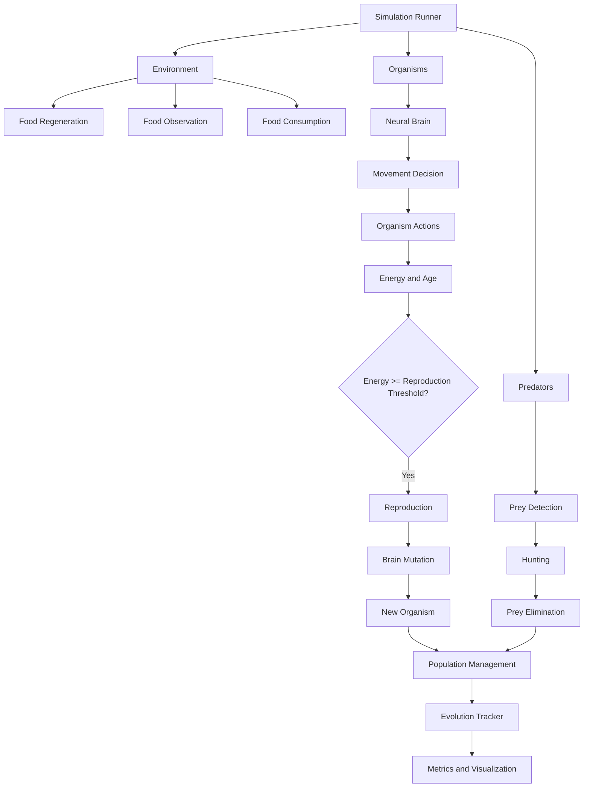
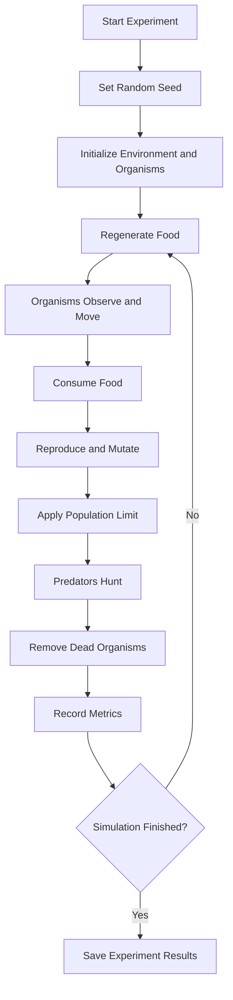

# Artificial Life — Digital Evolution Laboratory

A Python-based artificial-life simulation exploring how organisms survive, consume resources, reproduce, mutate, and interact with predators in a dynamic environment.

The project investigates how mutation rates influence population dynamics and evolutionary outcomes through controlled, multi-seed experiments.

## 1. Project Overview

The simulation contains:

- **Environment:** 2D world with regenerating food resources.
- **Organisms:** Autonomous agents with neural-network-based decision-making.
- **Neural brains:** Small neural networks controlling movement toward food.
- **Reproduction:** Organisms reproduce when their energy reaches a threshold.
- **Mutation:** Offspring inherit modified neural-network parameters.
- **Predators:** Agents that detect and hunt nearby organisms.
- **Evolution tracking:** Records population, fitness, age, and generation metrics.
- **Experiments:** Compares different mutation rates across multiple random seeds.

## 2. System Architecture



## 3. Evolution Experiment Workflow



## 4. Project Structure

```text
Artificial-Life/
│
├── agents/
│   ├── organism.py
│   ├── predator.py
│   └── brain.py
│
├── core/
│   └── environment.py
│
├── experiments/
│   ├── evolution.py
│   ├── runner.py
│   ├── run_comparison.py
│   └── validation.py
│
├── visualization/
│   └── dashboard.py
│
├── main.py
├── experiment_results.csv
├── experiment_runs.csv
└── README.md
```

## 5. Installation

Requirements:

- Python 3.10+
- NumPy
- SciPy
- Matplotlib
- Pandas

Install dependencies:

```bash
pip install numpy scipy matplotlib pandas
```

## 6. Running the Simulation

Run the main simulation:

```bash
python main.py
```

Run mutation-rate comparison experiments:

```bash
python -m experiments.run_comparison
```

The comparison experiment evaluates three mutation strategies:

| Strategy | Mutation rate |
|---|---:|
| Baseline | 0% |
| Low Mutation | 5% |
| High Mutation | 20% |

Each strategy is evaluated using five random seeds, giving 15 experiment runs in total.

## 7. Experimental Results

Latest observed results:

| Metric | Baseline | Low Mutation | High Mutation |
|---|---:|---:|---:|
| Population | 84.60 ± 24.45 | 82.40 ± 39.35 | 100.00 ± 0.00 |
| Average fitness | 381.01 ± 46.04 | 328.26 ± 98.80 | 301.14 ± 64.98 |
| Average age | 300.53 ± 42.05 | 243.68 ± 116.05 | 210.98 ± 69.49 |
| Maximum generation | 10.00 ± 3.81 | 8.80 ± 4.82 | 8.60 ± 2.41 |

Values are reported as mean ± sample standard deviation across five runs.

### Initial observations

1. The baseline strategy achieved the highest average fitness.
2. Low mutation showed the greatest variability in average fitness and age.
3. High mutation reached the population limit in all five runs.
4. Reaching the population limit did not correspond to higher average fitness.

These observations describe this simulation setup; they do not establish that mutation generally reduces evolutionary performance.

## 8. Output Files

| File | Purpose |
|---|---|
| `experiment_results.csv` | Aggregated metrics: mean and standard deviation |
| `experiment_runs.csv` | Individual experiment-run records |

These datasets can be used for further statistical analysis and visualization.

## 9. Scientific Limitations

This is an experimental artificial-life model, not a biologically accurate ecosystem.

Current limitations:

- Neural networks use randomly initialized weights and mutation; they do not perform gradient-based learning.
- Organism fitness is defined as age + energy, so age and fitness are not independent measures.
- The population cap introduces an additional selection pressure.
- Only five seeds are used per mutation strategy.
- The current experiment does not isolate every ecological factor.
- Better fitness does not necessarily indicate better neural-network behavior or intelligence.

## 10. Future Research Directions

Potential extensions:

- Measure lifetime reproductive success.
- Introduce predator-aware neural networks.
- Investigate adaptive mutation rates.
- Study resource competition and cooperation.
- Compare neural-network architectures.
- Analyze evolutionary diversity and genetic similarity.
- Increase the number of random seeds and conduct statistical tests.

## 11. Research Question

**How does the mutation rate influence survival, population dynamics, and generational development in a resource-limited artificial ecosystem?**

This project provides an experimental framework for investigating that question through computational simulation.

---

**Project:** Artificial-Life — Digital Evolution Laboratory  
**Language:** Python  
**Core areas:** Artificial Life, Neural Networks, Evolutionary Computation, Multi-Agent Simulation  
**Status:** Version 1 — Experimental prototype